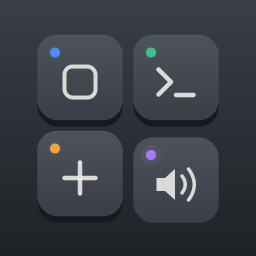
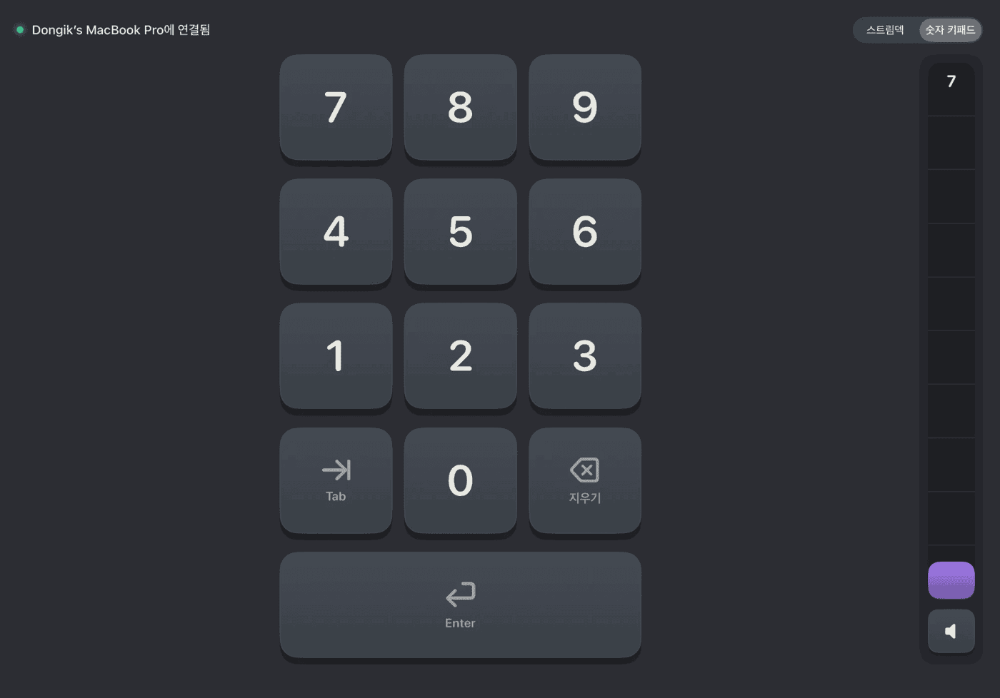
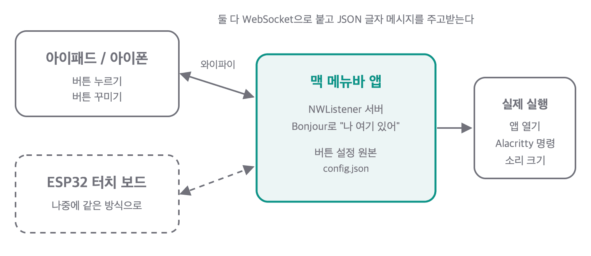

<p align="center">
  
</p>

<h1 align="center">TouchDeck</h1>

<p align="center">아이패드와 아이폰을 맥의 스트림덱처럼 쓰는 개인용 앱</p>

<p align="center">
  
</p>

모니터 옆에 세워 둔 아이패드에서 버튼을 누르면 맥에서 앱이 열리고, 터미널 명령이 돌고, 소리 크기가 바뀐다. 무각 키보드로 숫자 치기 어려울 때는 숫자 키패드로도 쓴다. 나중에 ESP32 터치 보드(CYD 2.8인치)를 같은 방식으로 붙이는 게 목표다.

외부 라이브러리 없이 애플 프레임워크만 쓴다.

---

## 할 수 있는 것

| 기능 | 설명 |
|---|---|
| 앱 실행 | 맥에 설치된 앱을 아이콘과 함께 골라 버튼에 올린다. 검색은 한글 이름, 영어 이름(`notes` → 메모), 초성(`ㅁㅁ` → 메모) 모두 된다 |
| 터미널 명령 | Alacritty 새 창을 열고 평소 쓰는 zsh에서 명령을 실행한다. `~/.zshrc`의 별칭도 그대로 된다. 실행할 폴더는 맥 폴더를 눌러 가며 고른다. 버튼마다 "끝나면 창 닫기"를 고를 수 있다 |
| 새 터미널 창 | Alacritty가 켜져 있어도 빈 창을 하나 더 연다 |
| 볼륨 게이지 | 실제 소리 크기만큼 차오르는 게이지. 맥북 스피커는 macOS로, DisplayPort/HDMI 모니터는 BetterDisplay로 값을 읽고 정한다. 키보드로 바꾼 소리도 3초 안에 따라온다 |
| 숫자 키패드 | 누른 키가 맥에서 앞에 떠 있는 앱에 입력된다. 화면과 로그 어디에도 친 숫자를 남기지 않는다 |
| 편집 | 빈 칸을 누르면 추가, 버튼을 길게 누르면 편집. 한 페이지 12칸, 옆으로 밀어 페이지를 넘긴다 |
| 연결 | 같은 와이파이에서 Bonjour로 맥을 자동으로 찾는다. 와이파이가 달라도 근처에 있으면 에어드롭처럼 기기끼리 직접 붙는다. 상태 줄에 어느 길로 붙었는지 보인다 |
| 맥 메뉴바 | 연결된 기기, 페어링 숫자, 허락한 기기와 허락 취소, 로그인 시 자동 실행 |

---

## 구조

<p align="center">
  
</p>

```
TouchDeck/            iOS·iPadOS 앱 (SwiftUI). 버튼판, 편집, 키패드, 볼륨 게이지
TouchDeckMac/         맥 메뉴바 앱. NWListener 서버, 앱 실행, Alacritty, 볼륨, 키 입력
Packages/DeckKit/     공용 Swift 패키지. 메시지, 버튼 배치, 페어링, 암호화, 검색 규칙
TouchDeckUITests/     시뮬레이터 UI 테스트
TouchDeckMacTests/    맥 앱 테스트
docs/                 화면 캡처, 구조 그림, 아이콘 원본(SVG)
```

- 버튼 설정의 원본은 맥(`~/Library/Application Support/TouchDeck/config.json`)에만 있다. 아이패드와 아이폰은 받아서 보여주고, 고칠 때는 맥에 요청한다. 그래서 여러 기기가 늘 같은 배치를 본다.
- 맥은 `NWListener` 하나로 WebSocket 서버(포트 52801)를 열고 Bonjour(`_touchdeck._tcp`)로 광고한다. 아이패드는 `NWBrowser`로 찾아 `NWConnection`으로 붙는다.
- 메시지는 최상위에 `type`이 있는 JSON 글자다. 나중에 ESP32도 같은 메시지로 붙을 수 있게 단순하게 유지한다.

---

## 보안

같은 와이파이의 누군가가 내 맥에 명령을 시킬 수 없게 하는 게 가장 중요한 조건이다.

- **페어링:** 처음 붙는 기기는 맥 메뉴바에 뜬 4자리 숫자를 입력해야 한다. 맥과 기기가 임시 키를 만들어 공개 키만 주고받고(X25519), 공유 비밀에 숫자를 섞어 토큰을 양쪽이 계산한다(HKDF-SHA256). 숫자와 토큰은 네트워크로 나가지 않는다.
- **찍어 보기 막기:** 숫자가 합쳐서 5번 틀리면 잠긴다. 맥 메뉴에서 "새 기기 허락 다시 받기"를 눌러야 풀린다.
- **다시 붙을 때:** 양쪽이 낸 무작위 값과 토큰으로 맥이 먼저 증명하고, 기기가 그다음 증명한다(HMAC-SHA256). 토큰을 모르는 가짜 맥은 걸러진다.
- **허락 뒤:** 모든 메시지를 이번 접속 전용 키로 암호화한다(ChaChaPoly). 번호를 같이 묶어서 다시 보내기와 위조를 막는다.
- **허락 전 제한:** 허락받지 않은 연결은 8개까지, 메시지는 8KB까지만 받는다.
- **남는 한계:** 맨 처음 페어링하는 순간에 누가 중간에 끼면 4자리 숫자를 오프라인으로 맞춰 볼 수 있다. 처음 한 번에만 해당한다.

쓰는 암호 기능(X25519, HKDF, HMAC-SHA256, ChaChaPoly)은 모두 ESP32의 Mbed TLS에도 있다.

---

## 필요한 것

- iPadOS/iOS 26 이상, macOS 26 이상, Xcode 27
- [XcodeGen](https://github.com/yonaskolb/XcodeGen) (`project.yml`로 Xcode 프로젝트를 만든다)
- 터미널 명령 버튼: [Alacritty](https://alacritty.org) (`/Applications/Alacritty.app`)
- 모니터 스피커 볼륨: [BetterDisplay](https://github.com/waydabber/BetterDisplay) (없으면 볼륨 키 신호로 한 칸씩 조절한다)

`project.yml`에 개발 팀(`DEVELOPMENT_TEAM: LA95MXQ3R5`)이 고정돼 있다. 손쉬운 사용 권한이 빌드마다 풀리지 않게 하려는 것이라, 다른 계정으로 빌드하려면 이 값을 자기 팀으로 바꾼다.

---

## 빌드와 설치

```bash
xcodegen generate
```

아이패드/아이폰 앱은 Xcode에서 `TouchDeck` scheme을 기기로 실행한다. `DeckKit` scheme은 공용 패키지라 실행하는 앱이 아니다(테스트용).

맥 앱은 매일 쓰려면 Release로 빌드해서 `/Applications`에 넣는다. 메뉴바 창의 "로그인 시 자동 실행"은 지금 실행 중인 앱 경로를 등록하기 때문에, Xcode에서 띄운 빌드로 켜면 그 빌드가 등록된다.

```bash
xcodebuild build -project TouchDeck.xcodeproj -scheme TouchDeckMac -configuration Release -derivedDataPath DerivedData -allowProvisioningUpdates
```

실행 중인 TouchDeck(Xcode에서 띄운 것 포함)을 먼저 끄고 복사한다. 포트 52801은 한 앱만 쓸 수 있다.

```bash
ditto DerivedData/Build/Products/Release/TouchDeck.app /Applications/TouchDeck.app
```

```bash
open /Applications/TouchDeck.app
```

그다음 메뉴바 창에서 "로그인 시 자동 실행"을 켠다. "시스템 설정 > 일반 > 로그인 항목에서 허용해 주세요"가 뜨면 거기서 TouchDeck을 허용한다.

---

## 처음 쓸 때 켜야 하는 권한

| 권한 | 어디서 | 왜 |
|---|---|---|
| 로컬 네트워크 | 아이패드/아이폰 (처음 실행할 때 창이 뜬다) | 같은 와이파이의 맥을 찾고 붙기 위해 |
| 손쉬운 사용 | 맥: 시스템 설정 > 개인정보 보호 및 보안 > 손쉬운 사용 | 볼륨 키 신호와 숫자 키패드 입력. 앱 위치마다 따로 받아서 `/Applications`로 옮기면 다시 켜야 할 수 있다 |
| 문서/데스크탑/다운로드 폴더 | 맥 (폴더 고르기에서 처음 읽을 때 창이 뜬다) | 폴더 고르기 화면에 하위 폴더를 보여주기 위해 |

---

## 테스트

```bash
cd Packages/DeckKit && swift test
```

```bash
xcodebuild test -project TouchDeck.xcodeproj -scheme TouchDeckMac -derivedDataPath DerivedData -allowProvisioningUpdates
```

시뮬레이터 UI 테스트(`TouchDeckUITests`)는 맥 앱을 디버그 빌드로 고정 페어링 숫자와 임시 설정 파일을 쓰게 띄운 뒤 돌린다.

```bash
TOUCHDECK_DEBUG_PAIR_CODE=4821 TOUCHDECK_DEBUG_CONFIG=/tmp/touchdeck-e2e.json ./DerivedData/Build/Products/Debug/TouchDeck.app/Contents/MacOS/TouchDeck
```

이 두 환경 변수는 디버그 빌드에서만 읽는다.

---

## 만든 과정

클로드 코드와 바이브 코딩으로 진행한 과정을 블로그에 정리했다. 만난 오류와 고친 과정, 참고한 애플 문서를 같이 적었다.

1. [아이패드와 맥이 같은 와이파이에서 서로를 찾아 붙기까지](https://haroldfromk.github.io/posts/StreamDeck-(1)/)
2. [맥에 설치된 앱 목록과 아이콘을 보내고, 눌러서 실행하기](https://haroldfromk.github.io/posts/StreamDeck-(2)/)
3. [버튼 하나로 Alacritty 새 창에서 별칭 명령 실행하기, 그리고 볼륨 키](https://haroldfromk.github.io/posts/StreamDeck-(3)/)
4. [키캡처럼 눌리는 버튼, 길게 눌러 편집하기, 옆으로 넘기는 페이지](https://haroldfromk.github.io/posts/StreamDeck-(4)/)
5. [아무나 내 맥을 못 건드리게 하는 4자리 숫자, 키 교환, 메시지마다 붙이는 서명](https://haroldfromk.github.io/posts/StreamDeck-(5)/)
6. [무각 키보드 대신 쓰는 아이패드 숫자 키패드, 그리고 메시지 암호화](https://haroldfromk.github.io/posts/StreamDeck-(6)/)
